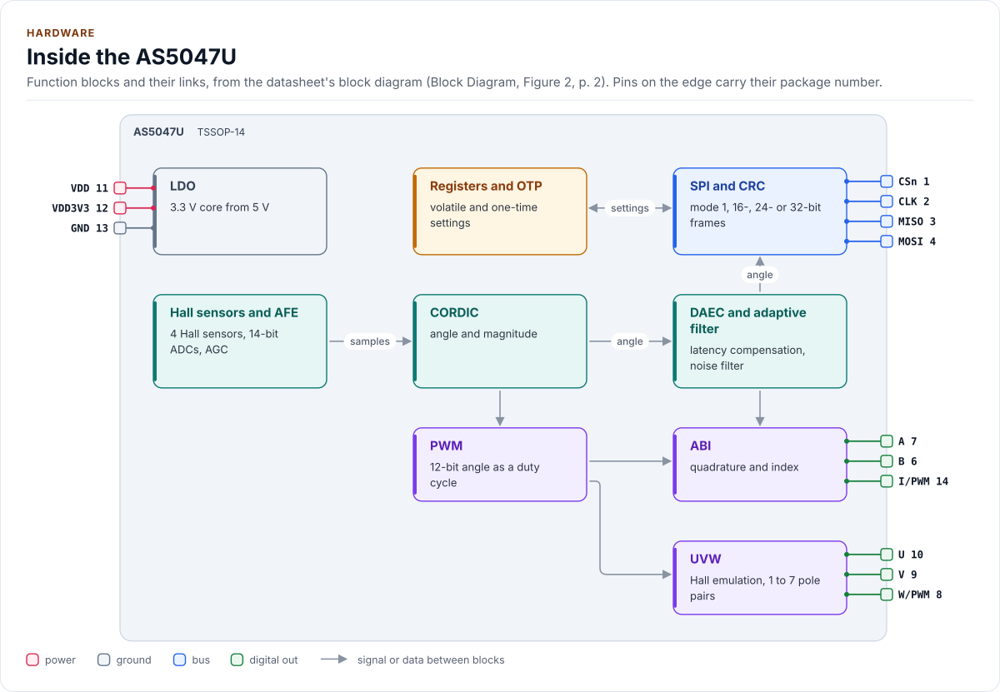
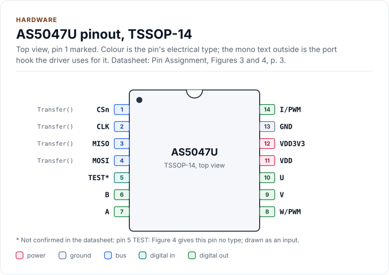
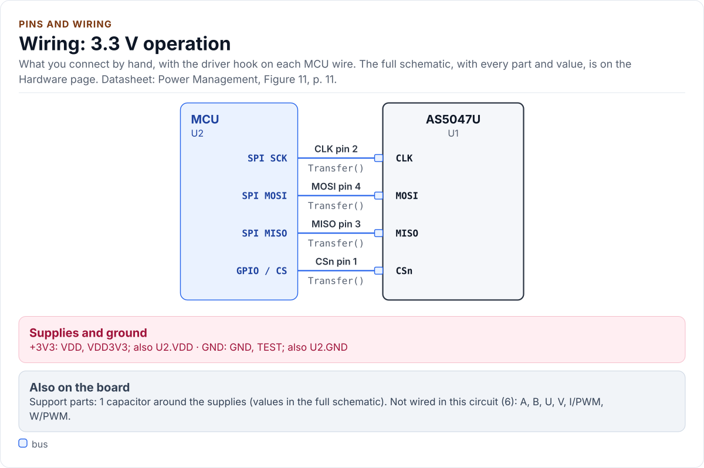
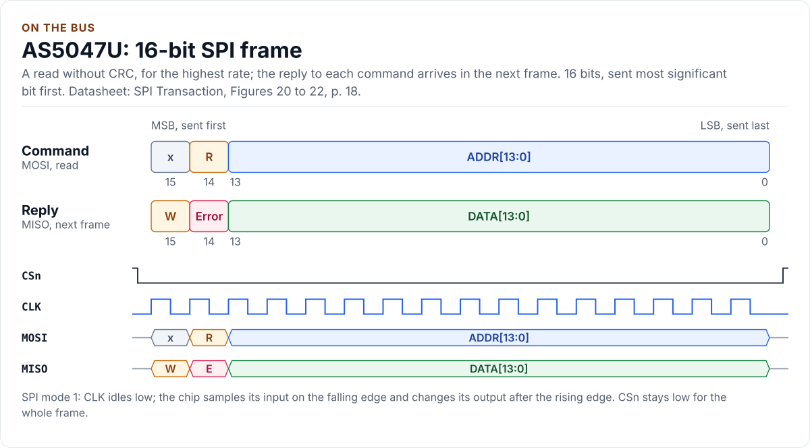
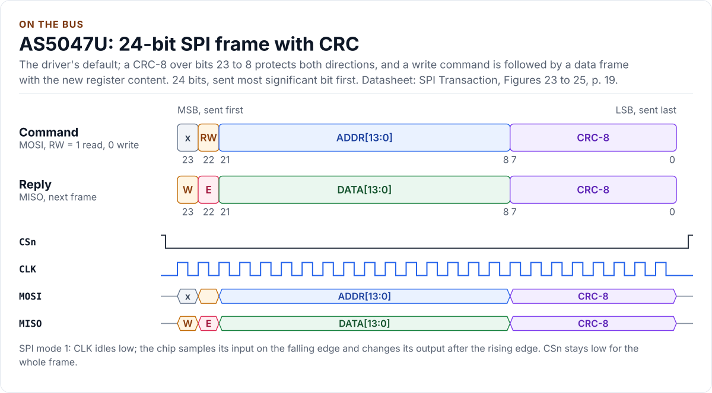
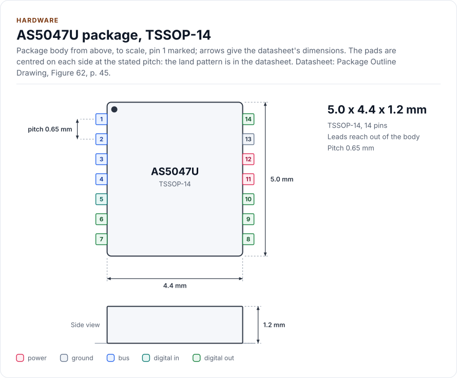

# AS5047U Driver

<!-- generated: chip-summary -->
The **AS5047U** is a magnetic rotary position sensor: it measures the absolute angle of a rotating magnet over a full
360 degrees in 14 bits and gives it over SPI with a CRC, and as incremental ABI, UVW commutation or PWM signals (General
Description, p. 1).
<!-- /generated -->

C++20 driver for the AS5047U 14-bit magnetic rotary position sensor.

[](https://github.com/kokeb-labs-drivers/driver-as5047u/actions/workflows/ci.yml)
[](LICENSE)
[](docs/installation.md#requirements)

**Documentation: <https://kokeb-labs-drivers.github.io/driver-as5047u/>**, with the API reference built by Doxygen under
[`api/`](https://kokeb-labs-drivers.github.io/driver-as5047u/latest/api/). The same pages are readable here in
[`docs/`](docs/index.md).

<!-- figure: chip-hero -->
<picture>
  <source media="(prefers-color-scheme: dark)" srcset="docs/diagrams/chip-hero.dark.svg">
  
</picture>
<!-- /figure -->

## What it does

<!-- figure: chip-capabilities -->
<picture>
  <source media="(prefers-color-scheme: dark)" srcset="docs/diagrams/chip-capabilities.dark.svg">
  
</picture>
<!-- /figure -->

## Where it is used

<!-- generated: chip-uses -->
- Factory automation
- Building automation
- Robotics
- Permanent magnet synchronous motors (PMSM)
- Closed-loop stepper motors
- Optical encoder replacement

Uses named by the datasheet (Applications, p. 2).
<!-- /generated -->

## Inside the chip

<!-- figure: chip-blocks -->
<picture>
  <source media="(prefers-color-scheme: dark)" srcset="docs/diagrams/chip-blocks.dark.svg">
  
</picture>
<!-- /figure -->

## Pins and wiring

<!-- figure: chip-pinout -->
<picture>
  <source media="(prefers-color-scheme: dark)" srcset="docs/diagrams/chip-pinout.dark.svg">
  
</picture>
<!-- /figure -->

<!-- figure: chip-wiring-supply-3v3 -->
<picture>
  <source media="(prefers-color-scheme: dark)" srcset="docs/diagrams/chip-wiring-supply-3v3.dark.svg">
  
</picture>
<!-- /figure -->

| MCU | AS5047U |
| --- | --- |
| SPI SCLK, MOSI, MISO | CLK (pin 2), MOSI (pin 4), MISO (pin 3) |
| Chip select | CSn (pin 1): low for one frame, high between frames |
| 3.3 V | VDD (pin 11) and VDD3V3 (pin 12), 100 nF to GND |
| GND | GND (pin 13) and TEST (pin 5) |

For 5 V operation, VDD (4.5 V to 5.5 V) feeds the on-chip regulator and VDD3V3 takes 1 µF to GND instead:
[Hardware](docs/hardware.md).

<!-- figure: chip-frame-spi16 -->
<picture>
  <source media="(prefers-color-scheme: dark)" srcset="docs/diagrams/chip-frame-spi16.dark.svg">
  
</picture>
<!-- /figure -->

<!-- figure: chip-frame-spi24 -->
<picture>
  <source media="(prefers-color-scheme: dark)" srcset="docs/diagrams/chip-frame-spi24.dark.svg">
  
</picture>
<!-- /figure -->

<!-- figure: chip-outline -->
<picture>
  <source media="(prefers-color-scheme: dark)" srcset="docs/diagrams/chip-outline.dark.svg">
  
</picture>
<!-- /figure -->

<!-- generated: chip-card -->
| | | Datasheet |
| --- | --- | --- |
| **Package** | TSSOP-14 | Pin Assignment, Figures 3 and 4, p. 3 |
| **Pins** | 14 | Pin Assignment, Figures 3 and 4, p. 3 |
| **Body size** | 5.0 x 4.4 x 1.2 mm | Package Outline Drawing, Figure 62, p. 45 |
| **Pin pitch** | 0.65 mm | Package Outline Drawing, Figure 62, p. 45 |
| **Supply VDD, 5 V operation** | 4.5 V to 5.5 V | Electrical Characteristics, Figure 6, p. 6 |
| **Supply VDD and VDD3V3, 3.3 V operation** | 3.0 V to 3.6 V | Electrical Characteristics, Figure 6, p. 6 |

From [`docs/hardware.yml`](docs/hardware.yml); pins, circuits and the block diagram: [Hardware](docs/hardware.md).
<!-- /generated -->

## Quick start

**1. Wire it** as in [Pins and wiring](#pins-and-wiring).

**2. Write the port**: a class with `EnsureInitialized()` (bring the bus up) and `Transfer()` (one full-duplex
frame), about 20 lines on most SDKs. [Porting](docs/porting.md) has the contract and a complete example.

**3. Read the angle:**

<!-- generated: quickstart-code -->
```cpp
#include "as5047u.hpp"

int read_shaft_angle(MyPort& port, float& degrees) {
  as5047u::AS5047U<MyPort> sensor(port); // no I/O yet

  if (auto r = sensor.EnsureInitialized(); !r) { // 1. bus up, wait for ready, Config{} written
    return static_cast<int>(r.error);            //    Bus or NoDevice: check wiring, SPI mode 1
  }
  const auto a = sensor.ReadAngleDegrees(); // 2. compensated angle, CRC-checked frame
  if (!a) {
    return static_cast<int>(a.error); //    MagnetWarning: magnet missing; DeviceFault: chip
  }
  degrees = a.value; // 3. [0, 360), 14-bit resolution (0.022 degrees)
  return 0;
}
```
<!-- /generated -->

`EnsureInitialized()` is the only call that starts the chip. Every other call returns `Error::NotInitialized`
until it has succeeded, and no read ever starts the chip on its own, so a read is always just its own frames.

## Driver coverage

<!-- generated: chip-coverage -->
| Capability | What the chip does | Driver API | Registers | Status | Datasheet |
| --- | --- | --- | --- | --- | --- |
| [Absolute angle](docs/api-guide.md) | Measures the magnet's angle over a full turn in 14 bits, with or without the dynamic compensation | `ReadAngleCounts`, `ReadAngleDegrees`, `ReadAngleRadians`, `ReadUncompensatedAngleCounts` | `ANGLECOM`, `ANGLEUNC` | Supported | System Specifications, Figure 8, p. 7 |
| [Rotation speed](docs/api-guide.md) | Measures the angular velocity in 14 bits, 24.141 °/s per count, up to 28000 rpm either way | `ReadVelocityCounts`, `ReadVelocityDegPerSec`, `ReadVelocityRpm` | `VEL` | Supported | Rotation Speed Measurement, Figure 16, p. 15 |
| [DAEC and adaptive filter](docs/configuration.md) | Corrects the angle for the measurement delay at speed, and filters transition noise at low speed | `ApplyConfig` | `SETTINGS2`, `SETTINGS1`, `DISABLE` | Supported | Dynamic Angle Error Compensation; Adaptive Filter System, p. 12 |
| [Zero position and direction](docs/api-guide.md) | Sets which angle reads 0 and which way the count rises, seen from above the chip | `SetZeroPosition`, `SetZeroHere`, `SetDirection` | `ZPOSM`, `ZPOSL`, `SETTINGS2` | Supported | Non-Volatile Registers (OTP), Figures 43 to 45, p. 28 |
| [ABI incremental interface](docs/configuration.md) | Quadrature A and B with an index pulse, 25 to 4096 pulses per revolution | `ApplyConfig`, `IncrementalOutput::Abi` | `SETTINGS3`, `SETTINGS2`, `DISABLE` | Supported | ABI Settings, Figure 51, p. 32 |
| [UVW commutation and PWM](docs/configuration.md) | Emulates the Hall switches of a BLDC motor for 1 to 7 pole pairs, or puts the angle out as PWM | `ApplyConfig`, `IncrementalOutput::Uvw` | `SETTINGS3`, `SETTINGS2`, `DISABLE` | Supported | UVW Commutation Interface, p. 33 |
| [Magnet and fault diagnostics](docs/troubleshooting.md) | Reports the gain control, the field magnitude and the error flags; each flag becomes a driver error | `ReadAgc`, `ReadMagnitude`, `ReadDiagnostics`, `ReadErrorFlags`, `CheckForReset` | `ERRFL`, `DIA`, `AGC`, `MAG` | Supported | Volatile Registers, Figure 33, p. 24 |
| [SPI frames with CRC](docs/hardware.md) | 16-bit frames for the fastest reads, or 24- and 32-bit frames with a CRC-8 and a daisy-chain pad byte | `FrameFormat::Bits24`, `ReadRegister`, `WriteRegister` | `NOP`, `ERRFL` | Supported | SPI Transaction, Figures 20 to 22, p. 18 |
| [OTP programming](docs/otp.md) | Burns the zero and the settings into the chip once, with the datasheet's step-by-step procedure | `ProgramOtp`, `ReadNonVolatile` | `PROG`, `ECC` | Guarded | Burn and Verification of the OTP Memory, p. 39 |

**Supported**: the driver covers it and a host test checks it; **Guarded**: covered, behind an explicit acknowledgement
because a wrong value can do harm.

From [`docs/hardware.yml`](docs/hardware.yml); `kokeb-docs hardware --check` confirms that every API name is in
`inc/as5047u.hpp`, `inc/as5047u_types.hpp` and every register in `inc/as5047u_registers.hpp`.
<!-- /generated -->

This driver reads the angle and the speed over SPI with a CRC on every frame, turns the chip's error flags into errors
you can act on, sets the zero, the direction and the encoder outputs, and burns the settings permanently when you ask it
to. It runs on any MCU: you give it a small class that moves bytes on your SPI bus, and it does the rest.

| | |
| --- | --- |
| **Bus** | SPI mode 1, up to 10 MHz; 16-bit frames, or 24- and 32-bit frames with CRC-8 (the default) |
| **Driver** | Header-only C++20; no heap, exceptions, RTTI or virtual calls; every call returns `Result<T>` |
| **Runs on** | Any MCU with SPI and a C++20 compiler; examples for ESP32 (ESP-IDF) and the host |
| **Status** | 0.1.0, not yet verified on hardware: host-tested against a frame-level model of the chip ([limitations](docs/limitations.md)) |

- Waits for the chip to report ready (DIA, confirmed by a second read, with a deadline from `Config`) before it
  writes anything, then writes the settings and reads each one back. A stuck, floating or looped-back line is
  `NoDevice`, never a value.
- Reads the angle (counts, degrees, radians, with or without dynamic compensation), the velocity (counts, °/s,
  rpm), the AGC and the magnitude, the diagnostic and error registers.
- Resolves the error bit of every reply through the chip's ERRFL register into `Crc`, `Framing`, `Command` or
  `DeviceFault`; an angle under a magnet warning is refused with `MagnetWarning`. Every ERRFL value it reads is kept
  in a latch (`GetLatchedErrorFlags()`), and the angle read stays two frames when the reply carries no flag.
- Sets the zero (`SetZeroHere()`), the direction and the ABI, UVW and PWM outputs from one `Config`, whose
  defaults are the chip's reset values.
- Burns the settings into the OTP with the datasheet's step-by-step procedure, guarded by a confirmation value and
  reporting the step that failed.
- States its bus requirements as `constexpr` values (`kSpiMode`, `kMaxClockHz`, ...) for a port to `static_assert`.

## Documentation

| Page | Read it when you want to |
| --- | --- |
| [Quickstart](docs/quickstart.md) | Go from a bare chip to an angle on your MCU |
| [Hardware](docs/hardware.md) | Wire it, choose 3.3 V or 5 V, place the magnet, understand the SPI frames |
| [Porting](docs/porting.md) | Write the port class for your MCU's SDK |
| [API guide](docs/api-guide.md) | Use each call: start, measure, set the zero, watch the magnet, handle errors |
| [Configuration](docs/configuration.md) | Choose every setting, or keep a burned part's settings |
| [OTP programming](docs/otp.md) | Make the zero and the settings permanent |
| [Troubleshooting](docs/troubleshooting.md) | Find the cause of an error or a wrong reading |
| [Contract](docs/contract.md) | Know exactly what the driver promises, needs and returns |
| [Status and limitations](docs/limitations.md) | Decide whether it is ready for your use: what is and is not verified |
| [Ambiguities](docs/ambiguities.md) | See where the datasheet gives two answers and which one the driver takes |
| [Datasheet map](docs/datasheet.md) | Find the datasheet section behind each part of the driver |
| [API reference](docs/api-reference.md) | Look up a class or member (Doxygen; built by CI and locally) |

## Datasheet

<!-- generated: datasheet-card -->
| Document | Revision | Get it |
| --- | --- | --- |
| Datasheet: AS5047U High Resolution Rotary Position Sensor (ams OSRAM DS000637) | v1-01, 2020-12-16 | [vendor page](https://ams-osram.com/products/sensor-solutions/position-sensors/ams-as5047u-high-resolution-rotary-position-sensor) |

Written against these revisions; the SHA-256 of each file is in [`docs/datasheets.yml`](docs/datasheets.yml). Where each
part of the driver is in the datasheet: [Datasheet map](docs/datasheet.md).
<!-- /generated -->

Every docs page lists the datasheet sections it relies on, and code comments cite the section they implement.

## Try it on your PC

No hardware needed: [`examples/host`](examples/host/README.md) runs the real driver against a simulated chip. You need
git, CMake 3.16+ and a C++20 compiler (GCC 10+, Clang 13+ or MSVC 2022).

1. Get the source:

   ```bash
   git clone https://github.com/kokeb-labs-drivers/driver-as5047u.git && cd driver-as5047u
   ```

2. Build and run the example:

   ```bash
   cmake -S examples/host -B build-example
   cmake --build build-example
   ./build-example/as5047u_host_example
   ```

3. You should see the simulated shaft turn in 30° steps:

   ```text
   AS5047U driver 0.1.0 on the host
   as5047u: initialised
   angle    0.00 deg  AGC 128
   angle   29.99 deg  AGC 128
   ```

To run the whole test suite instead: `cmake -S . -B build -DAS5047U_BUILD_TESTS=ON && cmake --build build && ctest
--test-dir build`.

## Add it to your project

Pick the row that matches your build; each is a few steps, and [Installation](docs/installation.md) has the details.

| Your build | Steps below |
| --- | --- |
| Plain CMake: STM32 (CubeMX), RP2040 (Pico SDK), nRF Connect, a host app | [A](#a-cmake-any-mcu) |
| ESP-IDF | [B](#b-esp-idf) |
| An SDK or OS image that installs libraries | [C](#c-installed-package) |

### A. CMake, any MCU

1. Add the driver as a submodule, pinned to the version you chose:

   ```bash
   git submodule add https://github.com/kokeb-labs-drivers/driver-as5047u.git external/driver-as5047u
   ```

2. In your `CMakeLists.txt`, after `project()`:

   ```cmake
   add_subdirectory(external/driver-as5047u)
   target_link_libraries(my_app PRIVATE as5047u::as5047u)   # brings the headers and C++20
   ```

3. In your code, `#include "as5047u.hpp"`, write the port ([Porting](docs/porting.md)) and build. A first build
   that compiles the quickstart above is the check that the driver is wired in.

### B. ESP-IDF

1. Add the driver under your project's `components/`; ESP-IDF finds it there and names it after the folder:

   ```bash
   git submodule add https://github.com/kokeb-labs-drivers/driver-as5047u.git components/as5047u
   ```

2. In `main/CMakeLists.txt`, list it: `idf_component_register(SRCS "main.cpp" REQUIRES as5047u)`.
3. `idf.py menuconfig` now has an **AS5047U rotary position sensor** menu (frame format, direction, DAEC), and
   `idf.py build` builds the driver with your app.
   [`examples/esp32`](examples/esp32) is a complete project with an SPI port.

### C. Installed package

1. Install it once into a prefix:

   ```bash
   cmake -S external/driver-as5047u -B build-as5047u && cmake --install build-as5047u --prefix /opt/sdk
   ```

2. In your project, with `CMAKE_PREFIX_PATH=/opt/sdk`:

   ```cmake
   find_package(as5047u 0.1 REQUIRED)
   target_link_libraries(my_app PRIVATE as5047u::as5047u)
   ```

The target is `as5047u::as5047u` every way, so switching later changes nothing else.

## Tests and quality

```bash
cmake -S . -B build -DAS5047U_BUILD_TESTS=ON && cmake --build build && ctest --test-dir build
```

The host tests run the driver against a model of the chip's SPI protocol, fail every bus transfer of every operation in
turn, and produce each error the driver can return. A fuzzer corrupts, drops and replaces the chip's replies and checks
the driver's promises after every call, among them that no lost frame can ever burn the OTP. CI also builds for
Cortex-M0+ to M33F and ESP32, and gates coverage, complexity, sanitizers, fuzzing, clang-tidy, cppcheck and the [Kokeb
Labs handbook](https://github.com/kokeb-labs/handbook) rules. See [Testing](docs/testing.md), which lists every gate and
its limit.

## License

MIT. See [LICENSE](LICENSE).
