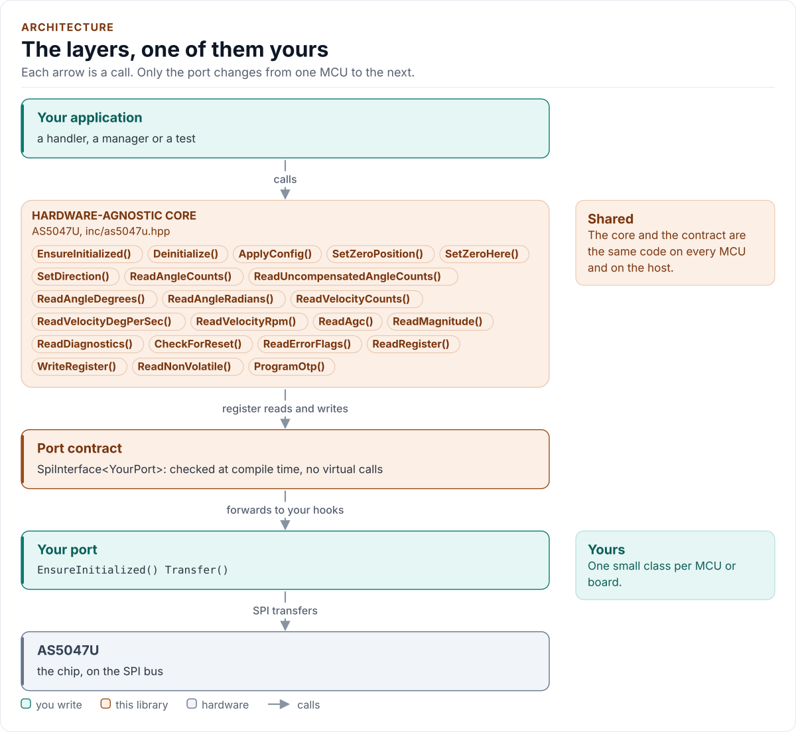
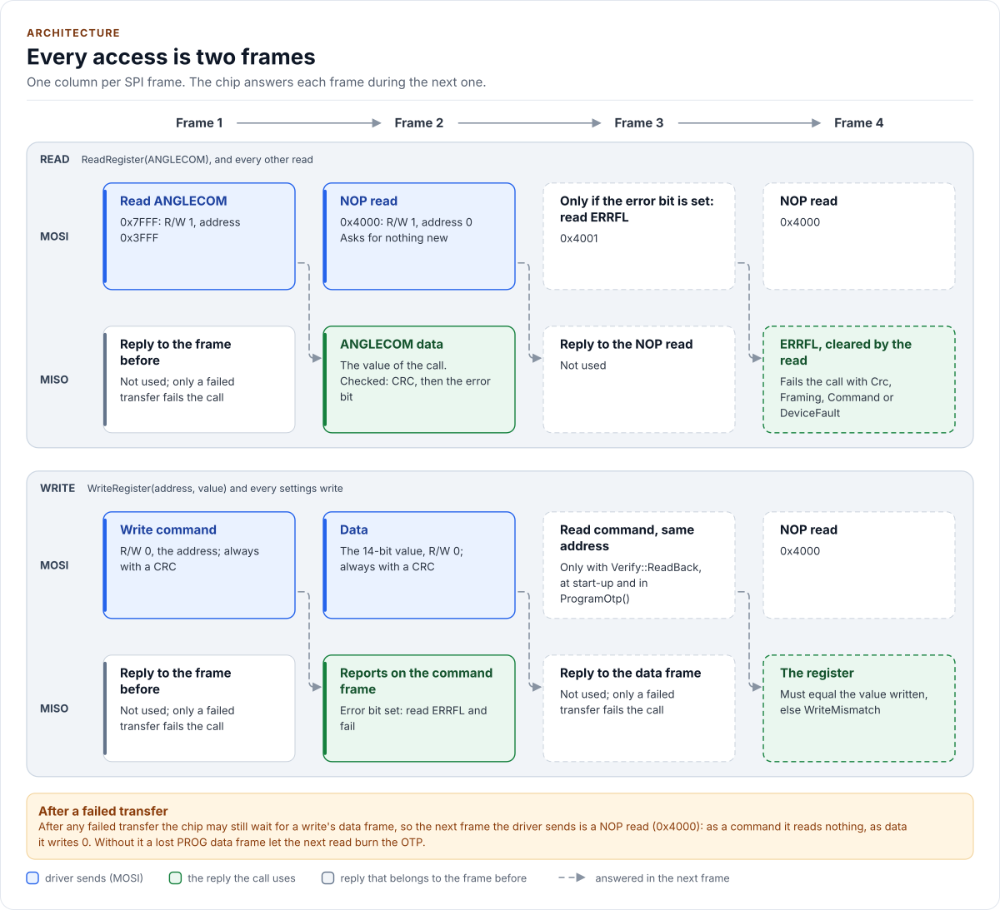

# Architecture

How the driver is built: three layers, one of them yours, and what happens in each when you read the angle.

<!-- generated: datasheet-refs -->
??? abstract "Datasheet sections this page relies on"

    From ams OSRAM DS000637 v1-01:

    - SPI mode, frames and the read pipeline: SPI Interface (Slave); SPI Transaction, p. 16

    All of them, with the driver API for each: [Datasheet map](datasheet.md).
<!-- /generated -->

<!-- figure: driver-layers -->
<picture>
  <source media="(prefers-color-scheme: dark)" srcset="diagrams/driver-layers.dark.svg">
  
</picture>
<!-- /figure -->

## Layers

| Layer | Files | Owns |
| --- | --- | --- |
| Core | [`inc/as5047u.hpp`](../inc/as5047u.hpp), [`src/as5047u.ipp`](../src/as5047u.ipp) | Lifecycle, configuration, read and write sequences, ERRFL handling, unit conversion, the OTP procedure, errors |
| Types and registers | [`inc/as5047u_types.hpp`](../inc/as5047u_types.hpp), [`inc/as5047u_registers.hpp`](../inc/as5047u_registers.hpp) | `Error`, `Result<T>`, `Config`, `Validate()`, the decoded ERRFL and DIA, `OtpReport`, `OtpBurnConfirm`; the register map and the CRC parameters |
| Compile-time helpers | [`inc/as5047u_detail.hpp`](../inc/as5047u_detail.hpp) | `detail::ExactHook<Port, Sig>` (exact hook matching), `kAlwaysFalse`, `ToUnderlying()`, `IsEnumerator()` |
| Port contract | [`inc/as5047u_spi_interface.hpp`](../inc/as5047u_spi_interface.hpp) | The bus requirements as `constexpr`, the CRTP base, the `SpiPort` concept, `Crc8()` and the frame layer (16, 24 and 32 bits) |
| Platform port | Your class | Bus bring-up and byte transfers, the delay and optionally logging |
| Kconfig layer | [`inc/as5047u_kconfig.hpp`](../inc/as5047u_kconfig.hpp) | Optional: a `Config` from ESP-IDF menuconfig |

## One call through the layers

```mermaid
sequenceDiagram
    participant App as Your code
    participant Core as AS5047U<Port>
    participant Port as Your port
    App->>Core: ReadAngleDegrees()
    Core->>Port: Transfer(read ANGLECOM + CRC)
    Port-->>Core: true, reply to the previous frame
    Core->>Port: Transfer(read NOP + CRC)
    Port-->>Core: true, ANGLECOM + CRC
    Note over Core: CRC check; a flag bit set? read ERRFL (latched): error, or a magnet warning
    Note over Core: counts x 360 / 16384
    Core-->>App: Result<float>{123.45, Ok}
```

Every access takes at least two frames, because the chip answers a frame during the next one:

<!-- figure: read-pipeline -->
<picture>
  <source media="(prefers-color-scheme: dark)" srcset="diagrams/read-pipeline.dark.svg">
  
</picture>
<!-- /figure -->

## Design choices

- **CRTP, not virtual functions.** The port is a template parameter constrained by the `SpiPort` concept, so every
  call is resolved at compile time and a missing hook is a compile error that names it.
- **Exact port concepts.** `SpiPort` matches each hook's address with `detail::ExactHook<Port, Sig>`, which takes a
  member function of exactly that `noexcept` signature and converts no value: a narrowed length or a throwing hook
  is a compile error, not a silent truncation.
- **Hooks by named concepts.** `DelayUs` and `Log` are detected by `Declares*`/`Has*` concepts in one place. A
  missing `DelayUs()` fails to compile at `EnsureInitialized()`, a missing `Log()` logs nothing, a misdeclared one
  is a compile error; none is skipped silently.
- **The frame layer belongs to the driver.** The port moves bytes; the driver builds every frame, computes and
  checks the CRC and sends writes as CRC-protected frames whatever the read format.
- **A flagged reply is resolved, never ignored.** The reply's error bit fails the call after ERRFL says why. Its
  warning bit refuses an angle or a velocity when ERRFL holds a field warning (`MagnetWarning`): a reading the
  chip says is under an out-of-range field is not a measurement. Every ERRFL value read goes into a latch, so no
  internal read hides a flag.
- **Ready means confirmed.** Start-up waits for DIA to report every loop finished, twice in a row, with a deadline
  from `Config`; a stuck or looped-back line cannot fake it.
- **A lean angle read.** Two frames and one test of the flag bits; a flagged reply costs two more. Verification
  that adds frames (`Verify::ReadBack`) is chosen per call and never applies to reads.
- **CRC by table.** `Crc8()` uses a 256-byte `constexpr` table, two lookups per word instead of 16 shift-and-XOR
  steps, checked against the bitwise definition at compile time and for all 65 536 words in a test. On the host
  the CRC is about three times faster per word (14 ns against 40 to 65 ns on a 64-bit host at `-O2`), and a 24-bit
  angle read with a stub port went from 13 to 70 ns to 6 to 16 ns across GCC 15 and Clang; a 16-bit read, which has
  no CRC, stays within a few nanoseconds of before. Either way the bus dominates: two 24-bit frames take 4.8 µs at
  10 MHz. On a target the table costs 256 bytes of flash (read-only data); not measured on an MCU yet.
- **No I/O in the constructor.** Construction cannot fail, so the driver can be a static or a member of a handler.
- **One error type.** `Result<T>` carries a value and an `Error`; nothing throws and nothing returns a bare
  `bool`.
- **No heap, no exceptions, no RTTI, no `std::function`, no `printf`.** The driver is a header-only template with
  no mutable static state.

## Source map

| You want | Read |
| --- | --- |
| The public API | [`inc/as5047u.hpp`](../inc/as5047u.hpp) |
| How a call is implemented | [`src/as5047u.ipp`](../src/as5047u.ipp) |
| Register addresses and bits | [`inc/as5047u_registers.hpp`](../inc/as5047u_registers.hpp) |
| The port contract | [`inc/as5047u_spi_interface.hpp`](../inc/as5047u_spi_interface.hpp) |

Next: [Contract](contract.md).
