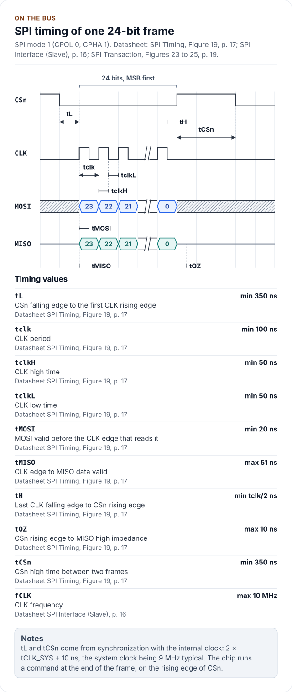

# On the bus

What the AS5047U needs from the SPI bus, signal by signal, with every time and rate taken from the datasheet. The
frames bit by bit (16, 24 and 32 bits) are on the [Hardware](hardware.md) page; this page is the waveform under them.

## SPI timing

The AS5047U uses SPI mode 1 (CPOL 0, CPHA 1): a frame starts with the falling edge of CSn while CLK is low, the chip
reads MOSI on the falling edge of CLK and runs the command when CSn rises; the clock goes up to 10 MHz (SPI
Interface (Slave), p. 16). The driver sends one frame per `Transfer()` call, 24 bits with a CRC-8 by default; the
[porting guide](porting.md#bus-requirements) lists the constants a port checks against.

<!-- figure: spi-timing -->
<picture>
  <source media="(prefers-color-scheme: dark)" srcset="diagrams/spi-timing.dark.svg">
  
</picture>
<!-- /figure -->

## Several devices

The datasheet names a daisy chain mode only through the 32-bit frame: its PAD word "is used to allocate the data on
MISO to the correct device" (PAD Word, p. 22). It shows no daisy-chain wiring and gives no device limit, so this page
draws no chain. Several AS5047U on one SPI bus share CLK, MOSI and MISO, each with its own CSn; MISO is released
within tOZ of CSn going high, so the other devices can drive it between frames.

## How these figures are made

Each figure is a model in `docs/model/` (`spi-timing.timing.yml`) that cites the datasheet section and page of every
number; `kokeb-docs figures` draws it and the build fails on a number without a citation. The values table under the
waveform is also written as `docs/diagrams/spi-timing.table.html`.
