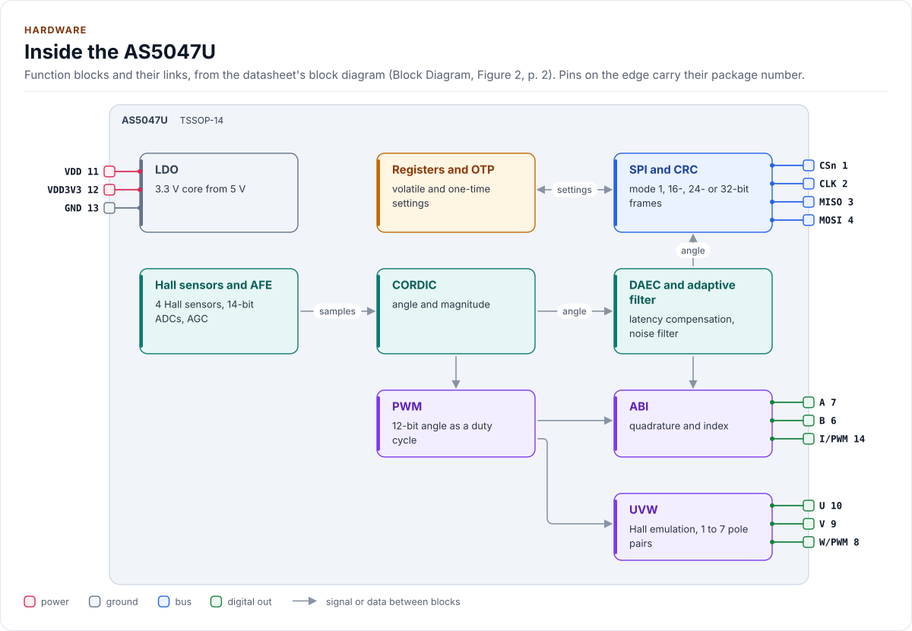
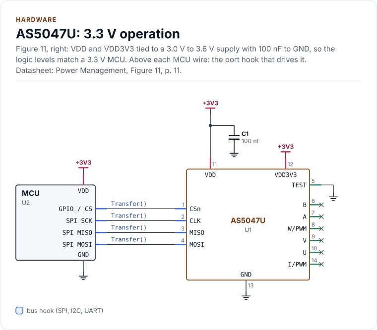
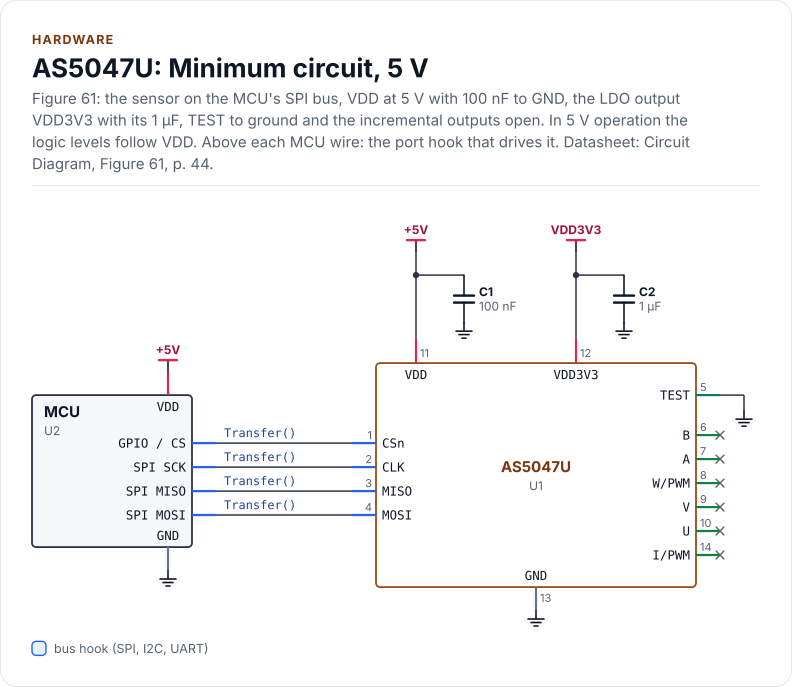
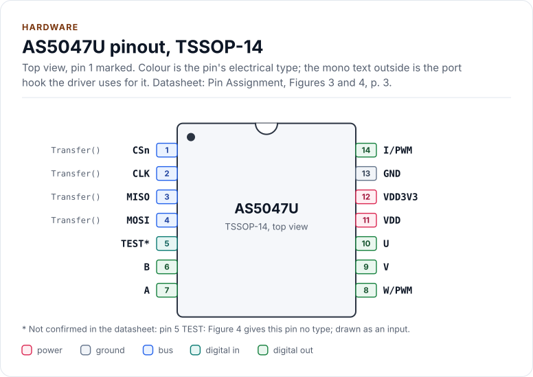
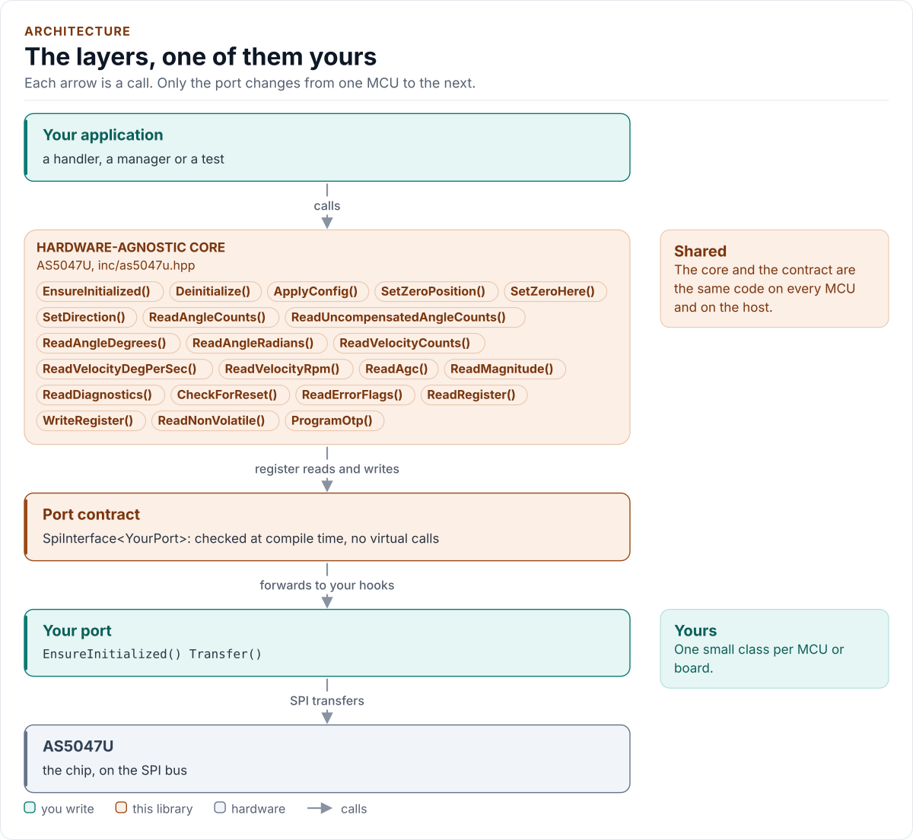
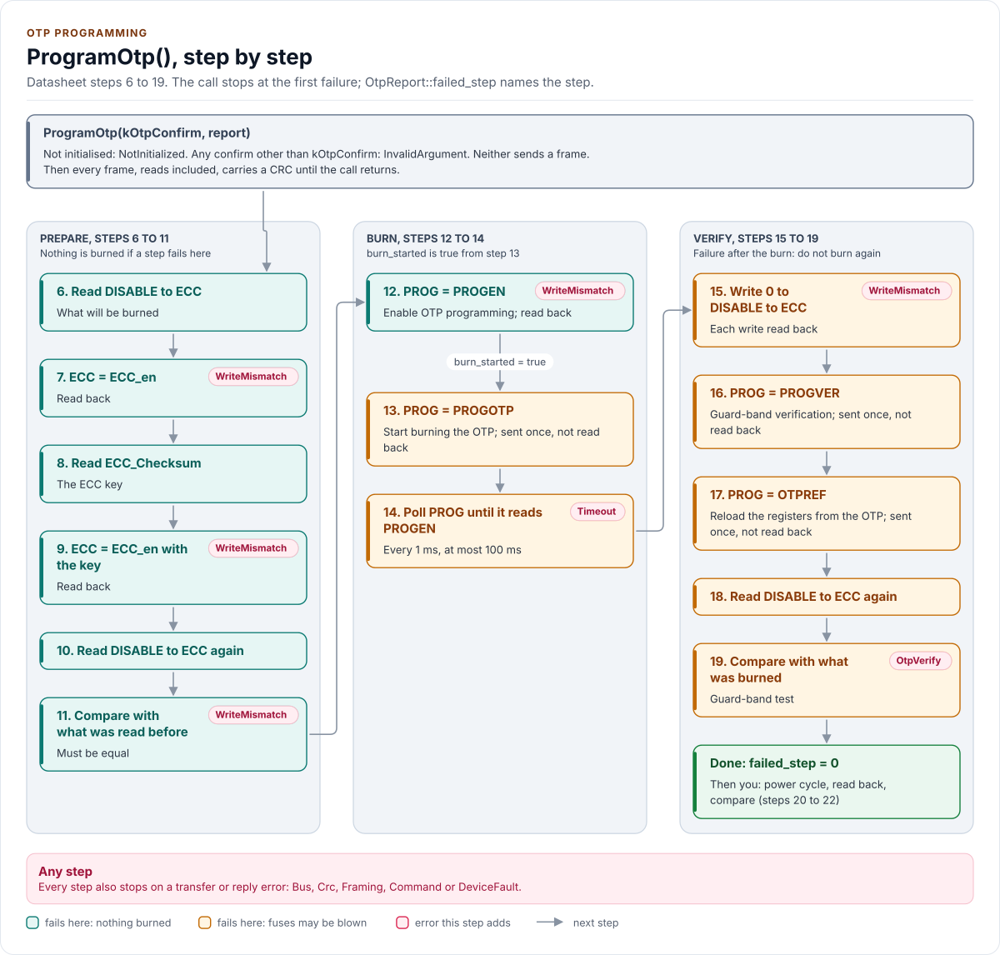
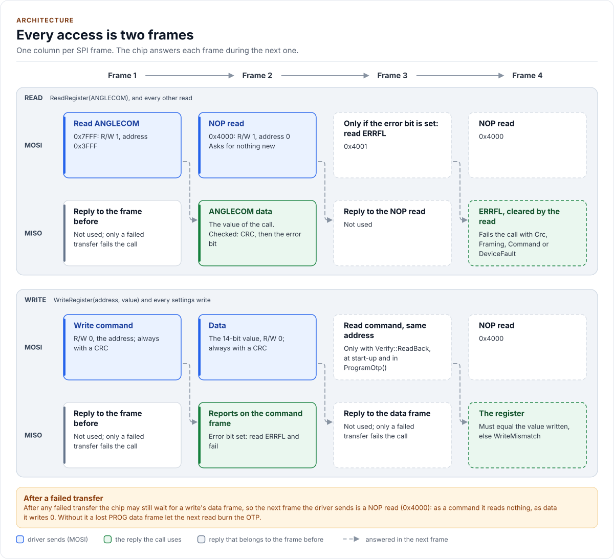
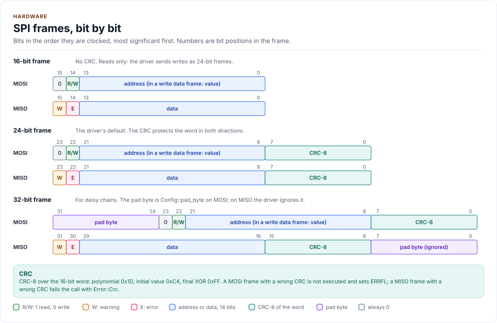

# Figures

<!-- Written by kokeb-docs figures from docs/diagrams/figures/*.py. Do not edit by hand. -->

Every figure on this site is drawn by a Python module from facts extracted from the code, so it is rebuilt,
not redrawn, when the code changes. CI runs `kokeb-docs figures --check` and fails when a
committed figure no longer matches the code. Each figure below lists the files it is drawn from.

## Inside the AS5047U

<!-- figure: chip-blocks -->
<picture>
  <source media="(prefers-color-scheme: dark)" srcset="chip-blocks.dark.svg">
  
</picture>
<!-- /figure -->

Hardware description: [`docs/hardware.yml`](../hardware.yml)

Drawn from:

- [`docs/hardware.yml`](../hardware.yml)
- [`inc/as5047u_spi_interface.hpp`](../../inc/as5047u_spi_interface.hpp)

## AS5047U: 3.3 V operation

<!-- figure: chip-circuit-supply-3v3 -->
<picture>
  <source media="(prefers-color-scheme: dark)" srcset="chip-circuit-supply-3v3.dark.svg">
  
</picture>
<!-- /figure -->

Hardware description: [`docs/hardware.yml`](../hardware.yml)

Drawn from:

- [`docs/hardware.yml`](../hardware.yml)
- [`inc/as5047u_spi_interface.hpp`](../../inc/as5047u_spi_interface.hpp)

## AS5047U: Minimum circuit, 5 V

<!-- figure: chip-circuit-typical -->
<picture>
  <source media="(prefers-color-scheme: dark)" srcset="chip-circuit-typical.dark.svg">
  
</picture>
<!-- /figure -->

Hardware description: [`docs/hardware.yml`](../hardware.yml)

Drawn from:

- [`docs/hardware.yml`](../hardware.yml)
- [`inc/as5047u_spi_interface.hpp`](../../inc/as5047u_spi_interface.hpp)

## AS5047U pinout, TSSOP-14

<!-- figure: chip-pinout -->
<picture>
  <source media="(prefers-color-scheme: dark)" srcset="chip-pinout.dark.svg">
  
</picture>
<!-- /figure -->

Hardware description: [`docs/hardware.yml`](../hardware.yml)

Drawn from:

- [`docs/hardware.yml`](../hardware.yml)
- [`inc/as5047u_spi_interface.hpp`](../../inc/as5047u_spi_interface.hpp)

## The layers, one of them yours

<!-- figure: driver-layers -->
<picture>
  <source media="(prefers-color-scheme: dark)" srcset="driver-layers.dark.svg">
  
</picture>
<!-- /figure -->

Figure module: [`docs/diagrams/figures/driver-layers.py`](../../docs/diagrams/figures/driver-layers.py)

Drawn from:

- `public calls` in [`inc/as5047u.hpp`](../../inc/as5047u.hpp)
- `SpiInterface` in [`inc/as5047u_spi_interface.hpp`](../../inc/as5047u_spi_interface.hpp)

## ProgramOtp(), step by step

<!-- figure: otp-flow -->
<picture>
  <source media="(prefers-color-scheme: dark)" srcset="otp-flow.dark.svg">
  
</picture>
<!-- /figure -->

Figure module: [`docs/diagrams/figures/otp-flow.py`](../../docs/diagrams/figures/otp-flow.py)

Drawn from:

- `ProgramOtp` in [`src/as5047u.ipp`](../../src/as5047u.ipp)
- `otpPrepare` in [`src/as5047u.ipp`](../../src/as5047u.ipp)
- `otpBurn` in [`src/as5047u.ipp`](../../src/as5047u.ipp)
- `otpVerify` in [`src/as5047u.ipp`](../../src/as5047u.ipp)
- `kOtpBurnTimeoutMs` in [`inc/as5047u_types.hpp`](../../inc/as5047u_types.hpp)
- `PROG and ECC` in [`inc/as5047u_registers.hpp`](../../inc/as5047u_registers.hpp)

## Every access is two frames

<!-- figure: read-pipeline -->
<picture>
  <source media="(prefers-color-scheme: dark)" srcset="read-pipeline.dark.svg">
  
</picture>
<!-- /figure -->

Figure module: [`docs/diagrams/figures/read-pipeline.py`](../../docs/diagrams/figures/read-pipeline.py)

Drawn from:

- `readRaw` in [`src/as5047u.ipp`](../../src/as5047u.ipp)
- `writeRaw` in [`src/as5047u.ipp`](../../src/as5047u.ipp)
- `resolveFlags` in [`src/as5047u.ipp`](../../src/as5047u.ipp)
- `detail::ClassifyErrorFlags` in [`inc/as5047u.hpp`](../../inc/as5047u.hpp)
- `frame bits` in [`inc/as5047u_registers.hpp`](../../inc/as5047u_registers.hpp)
- `FrameBus::Exchange` in [`inc/as5047u_spi_interface.hpp`](../../inc/as5047u_spi_interface.hpp)

## SPI frames, bit by bit

<!-- figure: spi-frames -->
<picture>
  <source media="(prefers-color-scheme: dark)" srcset="spi-frames.dark.svg">
  
</picture>
<!-- /figure -->

Figure module: [`docs/diagrams/figures/spi-frames.py`](../../docs/diagrams/figures/spi-frames.py)

Drawn from:

- `frame bits` in [`inc/as5047u_registers.hpp`](../../inc/as5047u_registers.hpp)
- `detail::FrameBus::Exchange` in [`inc/as5047u_spi_interface.hpp`](../../inc/as5047u_spi_interface.hpp)
- `Crc8` in [`inc/as5047u_spi_interface.hpp`](../../inc/as5047u_spi_interface.hpp)
- `writeFormat` in [`inc/as5047u.hpp`](../../inc/as5047u.hpp)
