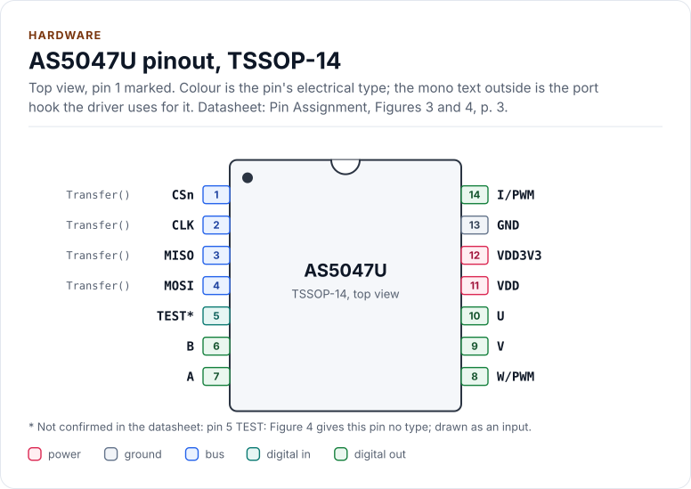
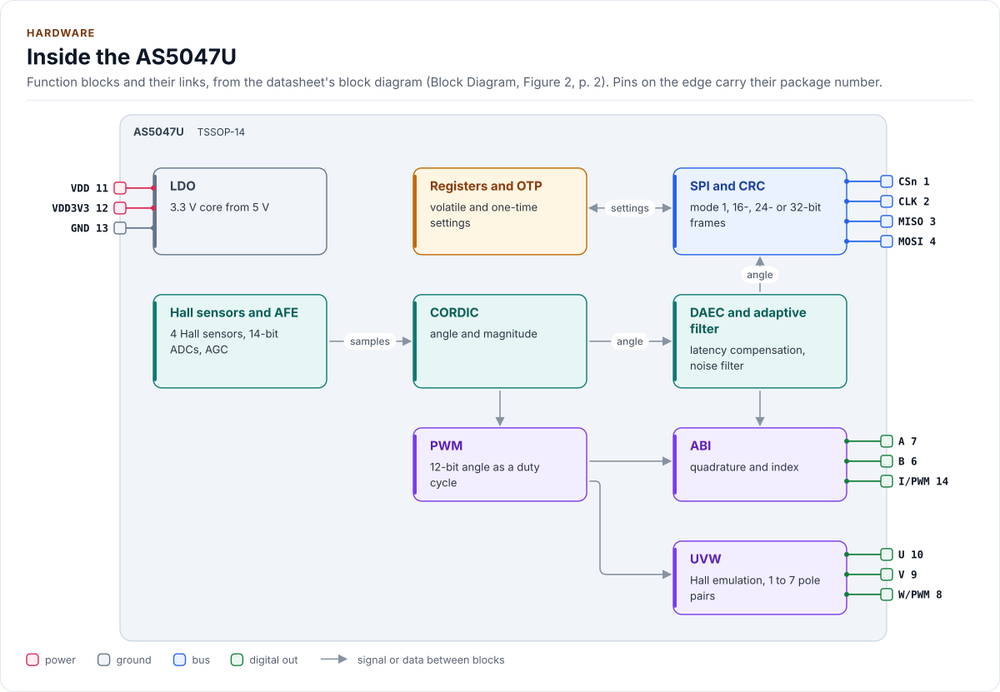
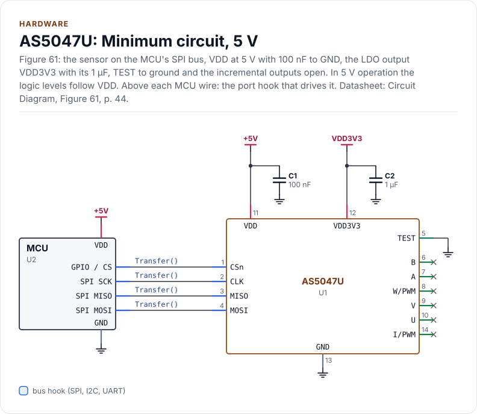
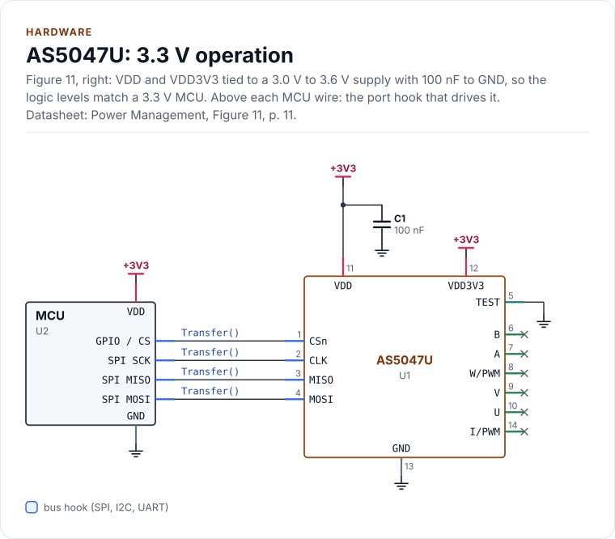
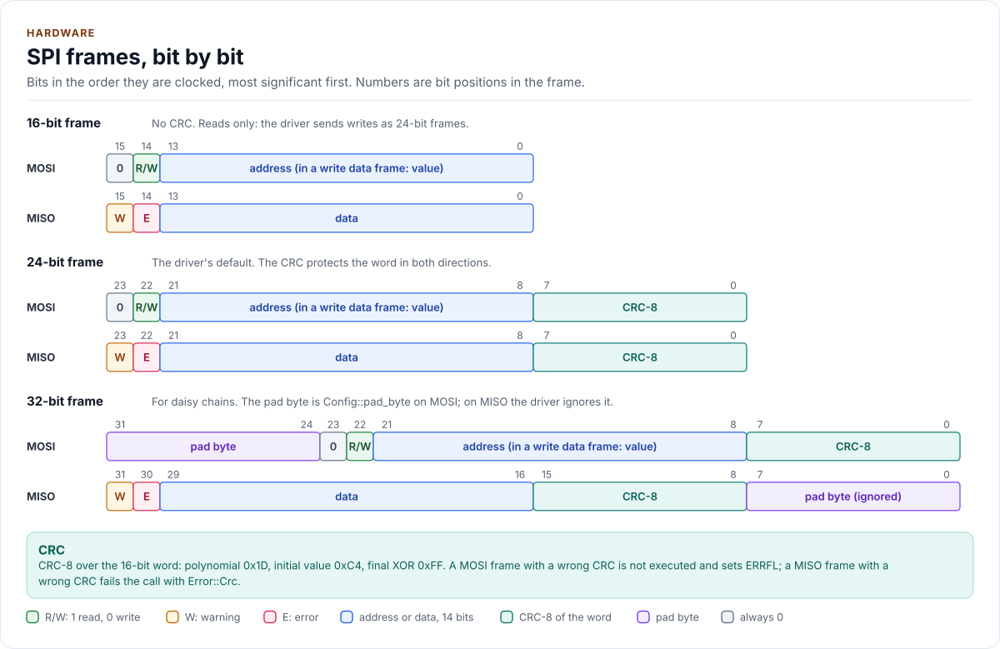
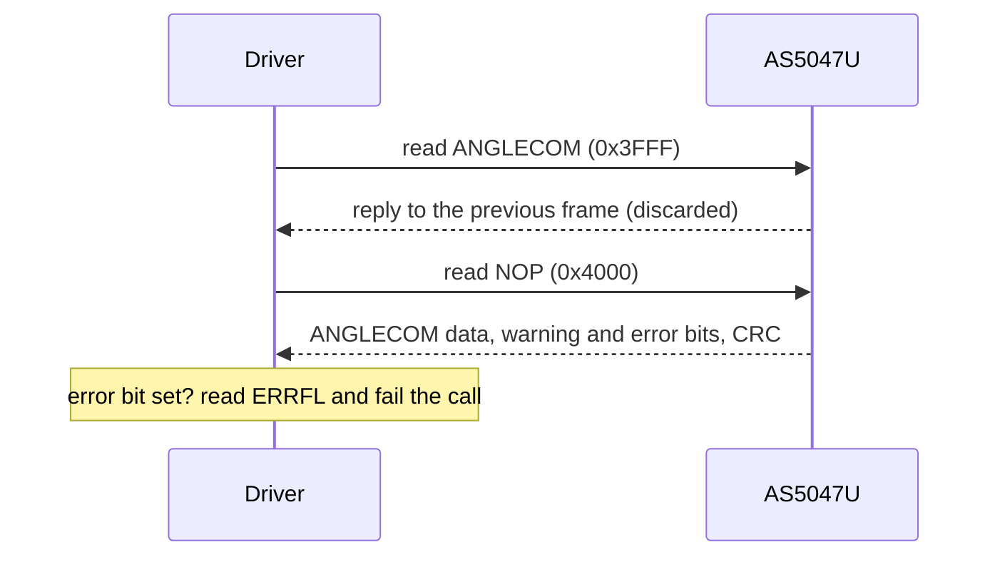

# Hardware

The AS5047U's pins, bus settings, frames, timing, power and magnet, as the driver uses them.

<!-- generated: datasheet-refs -->
??? abstract "Datasheet sections this page relies on"

    From ams OSRAM DS000637 v1-01:

    - Pins and package: Pin Assignment, p. 3
    - Supply voltage, 3.3 V and 5 V operation: Electrical Characteristics; Power Management, p. 6
    - Power-up time and SPI timing: Timing Characteristics; SPI Timing, p. 9
    - SPI mode, frames and the read pipeline: SPI Interface (Slave); SPI Transaction, p. 16
    - Pad byte of 32-bit frames: PAD Word, p. 22
    - CRC-8 of a frame: CRC Checksum, p. 23
    - Reference circuit: Circuit Diagram, p. 44
    - Package and magnet placement: Package Drawings & Markings; Mechanical Data, p. 45

    All of them, with the driver API for each: [Datasheet map](datasheet.md).
<!-- /generated -->

Every value on this page comes from the
[AS5047U datasheet](https://ams-osram.com/products/sensor-solutions/position-sensors/ams-as5047u-high-resolution-rotary-position-sensor)
(ams OSRAM DS000637, v1-01); figure numbers refer to it. The driver is **not verified on hardware** yet: the
values are the datasheet's, and the driver's behaviour against them is tested on the register model only.

## Pins

TSSOP-14 (Figures 3 and 4). Directions are seen from the chip. The pinout, the block diagram, the circuits and the
tables on this page are drawn from [`docs/hardware.yml`](hardware.yml).

<!-- figure: chip-pinout -->
<picture>
  <source media="(prefers-color-scheme: dark)" srcset="diagrams/chip-pinout.dark.svg">
  
</picture>
<!-- /figure -->

<!-- generated: chip-pins -->
TSSOP-14, 14 pins (Pin Assignment, Figures 3 and 4, p. 3).

| Pin | Name | Type (domain) | Function | Driver hook | If unused | Datasheet |
| --- | --- | --- | --- | --- | --- | --- |
| 1 | `CSn` | bus (VDD) | SPI chip select, active low | `Transfer()` | Pull up | Pin Assignment, Figures 3 and 4, p. 3 |
| 2 | `CLK` | bus (VDD) | SPI clock, up to 10 MHz, mode 1 | `Transfer()` | Pull down | SPI Interface (Slave), p. 16 |
| 3 | `MISO` | bus (VDD) | SPI data out | `Transfer()` | Leave open | Pin Assignment, Figures 3 and 4, p. 3 |
| 4 | `MOSI` | bus (VDD) | SPI data in | `Transfer()` | Pull down | Pin Assignment, Figures 3 and 4, p. 3 |
| 5 | `TEST` [^1] | digital in (VDD) | Test pin; connect to ground | - | Connect to GND | Pin Assignment, Figures 3 and 4, p. 3 |
| 6 | `B` | digital out (VDD) | Incremental signal B | - | Leave open | Pin Assignment, Figures 3 and 4, p. 3 |
| 7 | `A` | digital out (VDD) | Incremental signal A | - | Leave open | Pin Assignment, Figures 3 and 4, p. 3 |
| 8 | `W/PWM` | digital out (VDD) | Commutation signal W, or the PWM output | - | Leave open | Pin Assignment, Figures 3 and 4, p. 3 |
| 9 | `V` | digital out (VDD) | Commutation signal V | - | Leave open | Pin Assignment, Figures 3 and 4, p. 3 |
| 10 | `U` | digital out (VDD) | Commutation signal U | - | Leave open | Pin Assignment, Figures 3 and 4, p. 3 |
| 11 | `VDD` | power (VDD) | Supply: 4.5 V to 5.5 V into the on-chip LDO, or 3.0 V to 3.6 V tied to VDD3V3 | - | - | Electrical Characteristics, Figure 6, p. 6 |
| 12 | `VDD3V3` | power (VDD) | 3.3 V LDO output with 1 µF to GND; in 3.3 V operation tied to VDD | - | - | Pin Assignment, Figure 4, p. 4 |
| 13 | `GND` | ground | Ground | - | - | Pin Assignment, Figure 4, p. 4 |
| 14 | `I/PWM` | digital out (VDD) | Index signal I, or the PWM output | - | Leave open | Pin Assignment, Figure 4, p. 4 |

[^1]: Not confirmed in the datasheet: pin 5 (TEST): Figure 4 gives this pin no type; drawn as an input.

Source of this table and of the chip figures: [`docs/hardware.yml`](hardware.yml).
<!-- /generated -->

The chip has no reset pin and no interrupt pin, so the port has no GPIO hook. Digital inputs must never float.
The ABI, UVW and PWM outputs drive at most 4 mA at 5 V and 2 mA at 3.3 V, into at most 50 pF.

## Inside the chip

<!-- figure: chip-blocks -->
<picture>
  <source media="(prefers-color-scheme: dark)" srcset="diagrams/chip-blocks.dark.svg">
  
</picture>
<!-- /figure -->

## Circuits

The minimum circuit of Figure 61, with the 5 V supply: the on-chip LDO makes VDD3V3, which needs its own 1 µF and
powers nothing else. The ABI, UVW and PWM outputs are left open, as Figure 4 allows.

<!-- figure: chip-circuit-typical -->
<picture>
  <source media="(prefers-color-scheme: dark)" srcset="diagrams/chip-circuit-typical.dark.svg">
  
</picture>
<!-- /figure -->

With a 3.3 V supply, VDD and VDD3V3 are tied together (Figure 11), and the logic levels match a 3.3 V MCU without a
level shifter.

<!-- figure: chip-circuit-supply-3v3 -->
<picture>
  <source media="(prefers-color-scheme: dark)" srcset="diagrams/chip-circuit-supply-3v3.dark.svg">
  
</picture>
<!-- /figure -->

<!-- generated: chip-parts -->
**Minimum circuit, 5 V** (figure `chip-circuit-typical`)

| Part | Kind | Value | Connects | Datasheet |
| --- | --- | --- | --- | --- |
| U2 | MCU | - | VDD: +5V, GND: GND, SCK: CLK, MOSI: MOSI, MISO: MISO, CS: CSn | Circuit Diagram, Figure 61, p. 44 |
| C1 | capacitor | 100 nF | +5V, GND | Circuit Diagram, Figure 61, p. 44 |
| C2 | capacitor | 1 µF | VDD3V3, GND | Circuit Diagram, Figure 61, p. 44 |

**3.3 V operation** (figure `chip-circuit-supply-3v3`)

| Part | Kind | Value | Connects | Datasheet |
| --- | --- | --- | --- | --- |
| U2 | MCU | - | VDD: +3V3, GND: GND, SCK: CLK, MOSI: MOSI, MISO: MISO, CS: CSn | Power Management, Figure 11, p. 11 |
| C1 | capacitor | 100 nF | +3V3, GND | Power Management, Figure 11, p. 11 |

Export a circuit for a schematic or PCB tool: `kokeb-docs hardware --kicad-netlist OUT.net --circuit typical`.
<!-- /generated -->

## Bus settings

| Setting | Value |
| --- | --- |
| SPI mode | 1: CPOL = 0, CPHA = 1. The chip samples MOSI on the falling edge of CLK. Modes 0, 2 and 3 do not work |
| Clock | Up to 10 MHz (t_clk ≥ 100 ns) |
| Bit order | MSB first |
| Chip select | Active low, one frame per low period. CSn must go high between frames: the chip finds the frame length from the CSn low time and executes the frame on the rising edge |
| Reply | The reply to a frame arrives during the **next** frame |
| Driver default | 24-bit frames with CRC-8 (`FrameFormat::Bits24`) |

## Frames

"SPI Transaction" section, Figures 20 to 28. RW is 1 for a read and 0 for a write.

| Format | MOSI (host to chip) | MISO (chip to host) | Driver |
| --- | --- | --- | --- |
| 16 bit | `[14]` RW = 1, `[13:0]` address | `[15]` warning, `[14]` error, `[13:0]` data | `Bits16`: reads only, no CRC |
| 24 bit | `[22]` RW, `[21:8]` address or data, `[7:0]` CRC | `[23]` warning, `[22]` error, `[21:8]` data, `[7:0]` CRC | `Bits24`: the default |
| 32 bit | `[31:24]` pad, then the 24-bit frame | The 24-bit frame, then `[7:0]` pad | `Bits32`: daisy chains, pad from `Config::pad_byte` |

<!-- figure: spi-frames -->
<picture>
  <source media="(prefers-color-scheme: dark)" srcset="diagrams/spi-frames.dark.svg">
  
</picture>
<!-- /figure -->

The datasheet allows 16-bit frames for reads only, so with `Bits16` the driver sends every write as a 24-bit
frame. Writes are always CRC-protected, and `ProgramOtp()` sends every frame, reads included, as a 24-bit frame
whatever `Config::frame` says, then restores the format.

The CRC is CRC-8 with polynomial 0x1D, initial value 0xC4 and final XOR 0xFF, over the 16-bit word ("CRC
Checksum"); `as5047u::Crc8()` computes it. A MOSI frame with a wrong CRC is not executed and sets ERRFL.CRC_error.
A MISO frame with a wrong CRC fails the call with `Error::Crc`.

## Read and write sequences

A read is two frames: the read command, then a NOP whose reply carries the data. When the reply's error bit is set,
the driver reads ERRFL (two more frames, and the read clears it on the chip) to find out why.

A write is two frames, the command (RW = 0, address) and the data. The reply to the data frame reports on the
command frame. With `Verify::ReadBack`, and always in `EnsureInitialized()` and `ProgramOtp()`, each write is then
read back (two more frames) and compared. Brackets give the count with `Verify::ReadBack`.

| Call | Frames | Clock time, 24-bit frames at 10 MHz |
| --- | --- | --- |
| `ReadAngleCounts()` and every other single read, reply with no flag bit | 2 | 4.8 µs |
| The same with a flagged reply (ERRFL read) | 4 | 9.6 µs |
| `WriteRegister()` | 2 [4] | 4.8 µs [9.6 µs] |
| `ReadNonVolatile()` | 14 | 33.6 µs |
| `ApplyConfig()`, `SetZeroPosition()`, `SetDirection()` | 26 [38] | 62.4 µs [91.2 µs] |
| `EnsureInitialized()`, chip already up | 44 (20 with `write_settings = false`) | 105.6 µs (48 µs) |
| `EnsureInitialized()`, chip not yet ready | 2 more per poll, 1 ms apart, up to `startup_timeout_ms` | |
| `SetZeroHere()` | 54 [78] | 129.6 µs [187.2 µs] |
| `ProgramOtp()` | 100 at least, plus 2 per millisecond of burn time | 240 µs plus the burn |

The times are derived (3 bytes of clock per frame), not measured. Add at least 350 ns of CSn high time per frame
and your port's own overhead. A reply with the error bit set adds 2 frames for ERRFL.

## Timing

Figure 19. The two 350 ns limits are the ones a port can break: CSn low to the first clock edge, and CSn high
between two frames. A hardware chip select usually meets them; a GPIO chip select toggled right next to the
transfer may not.

| Symbol | Parameter | Min | Max | Unit |
| --- | --- | --- | --- | --- |
| t_L | CSn falling edge to first CLK rising edge | 350 | | ns |
| t_clk | Clock period | 100 | | ns |
| t_clkH, t_clkL | Clock high and low time | 50 | | ns |
| t_H | Last CLK falling edge to CSn rising edge | t_clk / 2 | | ns |
| t_CSn | CSn high time between frames | 350 | | ns |
| t_MOSI | MOSI valid before the clock edge | 20 | | ns |
| t_MISO | Clock edge to MISO valid | | 51 | ns |
| t_OZ | CSn rising edge to MISO high impedance | | 10 | ns |
| t_pon | VDD above its minimum to the first valid angle | | 10 | ms |

`EnsureInitialized()` covers t_pon itself: it polls DIA once per millisecond until every loop reports finished, for
at most `Config::startup_timeout_ms` (default 10 ms, t_pon). The deadline counts from the first poll, so raise it if
your supply ramps slowly or the start comes before VDD is up. The only other wait is in `ProgramOtp()`, 1 ms between
polls of the burn. Both go through the port's `DelayUs()`.

## Power

| Mode | Supply pins | Temperature | Angle noise (rms) |
| --- | --- | --- | --- |
| 5 V | VDD 4.5 V to 5.5 V; VDD3V3 is the LDO output, 1 µF to GND | -40 °C to 150 °C | 0.068° |
| 3.3 V, NOISESET = 0 | VDD and VDD3V3 tied, 3.0 V to 3.6 V | -40 °C to 125 °C | 0.068° |
| 3.3 V, NOISESET = 1 | VDD and VDD3V3 tied, 3.0 V to 3.6 V | -40 °C to 150 °C | 0.082° |

- `Config::high_temperature_noise` sets NOISESET, for 150 °C operation at 3.3 V.
- Supply current is at most 16 mA. Put 100 nF from VDD to GND in both modes.
- Logic levels follow VDD: V_IH ≥ 0.7 × VDD, V_IL ≤ 0.3 × VDD. In 5 V mode a 3.3 V MCU needs a level shifter on
  CLK, MOSI and CSn (0.7 × 4.5 V = 3.15 V), and MISO swings up to VDD.
- Absolute maximum: 7.0 V on VDD, 5.0 V on VDD3V3.
- The chip has no low-power mode: `Deinitialize()` does no I/O.
- `ReadDiagnostics().value.vdd_5v` is true in 5 V mode.
- Burning the OTP has its own supply and temperature limits: [OTP programming](otp.md#conditions).

## Magnet

| Parameter | Value |
| --- | --- |
| Type | Diametrically magnetised (two poles across the diameter), centred on the package axis |
| Field at the die | 35 mT to 70 mT, orthogonal component, along a circle of 1.1 mm radius |
| Datasheet reference magnet | N35H, 8 mm diameter, 3 mm thick |
| Speed | Up to 28000 rpm |
| Accuracy (optimal placement) | ±0.8° at 25 °C, ±1° over -40 °C to 150 °C (maximum non-linearity) |

The AGC keeps the field magnitude constant while the field is in range. `ReadAgc()` near 0 means the field is too
strong (magnet too close), near 255 too weak (too far); ERRFL.AGC_warning is set at either limit. Read ERRFL or AGC
regularly: the datasheet requires one of them to be read for the AGC loop to work as specified.

## Outputs other than SPI

| Output | Pins | What it carries | `Config` fields |
| --- | --- | --- | --- |
| ABI | A, B, I/PWM | Quadrature, 25 to 4096 pulses per revolution; index once per revolution, 3 LSB or 1 LSB wide | `incremental`, `abi_enable`, `abi_resolution_code`, `abi_decimal`, `index_width`, `hysteresis_code` |
| UVW | U, V, W/PWM | Hall-sensor emulation for 1 to 7 pole pairs | `incremental`, `uvw_enable`, `uvw_pole_pairs` |
| PWM | W/PWM or I/PWM | 12-bit angle in a frame of 4119 PWM clocks of 444 ns typical (about 1.83 ms) | `pwm_enable` |

The PWM goes on pin W when ABI is selected and on pin I when UVW is selected (SETTINGS2.UVW_ABI).
`Config::uncompensated_at_angle_register` (SETTINGS2.Data_select) makes address 0x3FFF and the PWM output carry the
angle without DAEC. [Configuration](configuration.md) maps each field to its register.

## Reference documents

<!-- generated: datasheet-card -->
| Document | Revision | Get it |
| --- | --- | --- |
| Datasheet: AS5047U High Resolution Rotary Position Sensor (ams OSRAM DS000637) | v1-01, 2020-12-16 | [vendor page](https://ams-osram.com/products/sensor-solutions/position-sensors/ams-as5047u-high-resolution-rotary-position-sensor) |

Written against these revisions; the SHA-256 of each file is in [`docs/datasheets.yml`](datasheets.yml). Where each part
of the driver is in the datasheet: [Datasheet map](datasheet.md).
<!-- /generated -->

| Also useful | Contents |
| --- | --- |
| Application note *AS5x47U Adaptive Filter* (ams OSRAM, from the same vendor page) | Choosing K_min and K_max for the velocity filter |
| [`inc/as5047u_registers.hpp`](../inc/as5047u_registers.hpp) | The register map as the driver uses it, with datasheet figure numbers |
