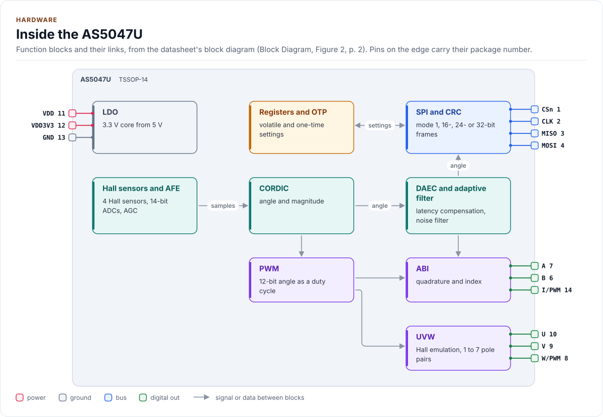
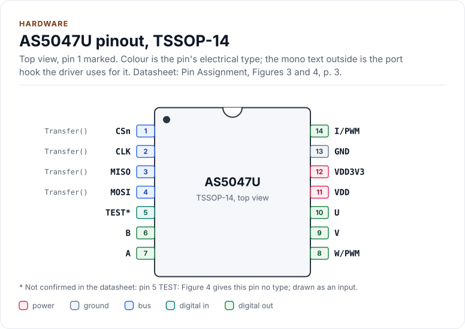
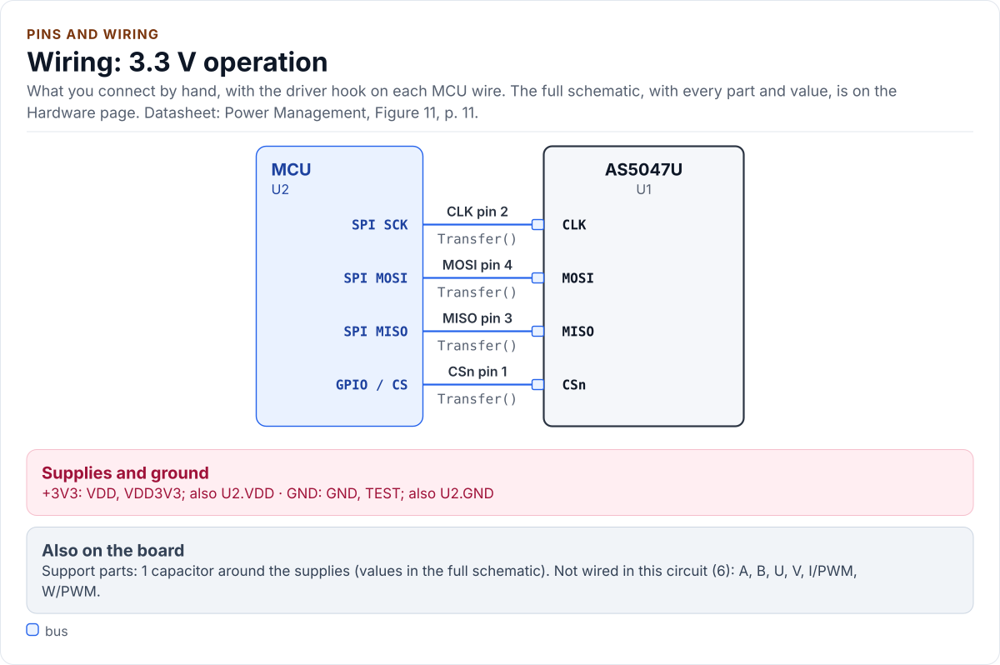
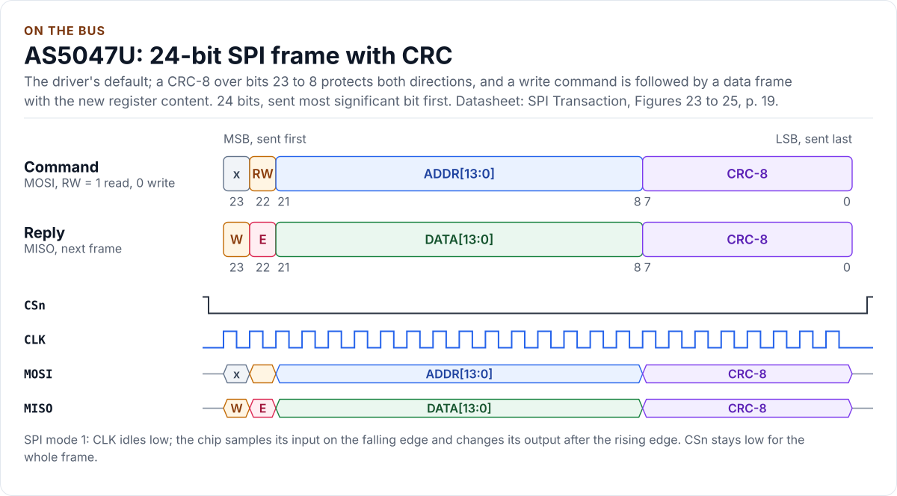

---
hide:
  - navigation
  - toc
---

<div class="kb-hero" markdown>
<span class="kb-kicker">Magnetic rotary position sensor</span>

# AS5047U Driver

<p>A C++20 driver for the AS5047U 14-bit magnetic rotary position sensor. It reads the angle and the velocity
over CRC-protected SPI frames, resolves the chip's error flags, sets the zero and the outputs, and burns the OTP,
on any MCU.</p>

[Quickstart](quickstart.md){ .md-button .md-button--primary }
[API guide](api-guide.md){ .md-button }
[Source on GitHub](https://github.com/kokeb-labs-drivers/driver-as5047u){ .md-button }
</div>

<!-- generated: chip-summary -->
The **AS5047U** is a magnetic rotary position sensor: it measures the absolute angle of a rotating magnet over a full
360 degrees in 14 bits and gives it over SPI with a CRC, and as incremental ABI, UVW commutation or PWM signals (General
Description, p. 1).
<!-- /generated -->

<!-- figure: chip-hero -->
<picture>
  <source media="(prefers-color-scheme: dark)" srcset="diagrams/chip-hero.dark.svg">
  
</picture>
<!-- /figure -->

## What it does

<!-- figure: chip-capabilities -->
<picture>
  <source media="(prefers-color-scheme: dark)" srcset="diagrams/chip-capabilities.dark.svg">
  
</picture>
<!-- /figure -->

## Where it is used

<!-- generated: chip-uses -->
- Factory automation (Applications, p. 2)
- Building automation (Applications, p. 2)
- Robotics (Applications, p. 2)
- Permanent magnet synchronous motors (PMSM) (Applications, p. 2)
- Closed-loop stepper motors (Applications, p. 2)
- Optical encoder replacement (Applications, p. 2)

Uses named by the datasheet (General Description, p. 1).
<!-- /generated -->

## Inside the chip

<!-- figure: chip-blocks -->
<picture>
  <source media="(prefers-color-scheme: dark)" srcset="diagrams/chip-blocks.dark.svg">
  
</picture>
<!-- /figure -->

## Pins and wiring

<!-- figure: chip-pinout -->
<picture>
  <source media="(prefers-color-scheme: dark)" srcset="diagrams/chip-pinout.dark.svg">
  
</picture>
<!-- /figure -->

<!-- figure: chip-wiring-supply-3v3 -->
<picture>
  <source media="(prefers-color-scheme: dark)" srcset="diagrams/chip-wiring-supply-3v3.dark.svg">
  
</picture>
<!-- /figure -->

<!-- figure: chip-frame-spi24 -->
<picture>
  <source media="(prefers-color-scheme: dark)" srcset="diagrams/chip-frame-spi24.dark.svg">
  
</picture>
<!-- /figure -->

Every pin, 5 V operation, the 16- and 32-bit frames, the timing and the magnet: [Hardware](hardware.md).

## Quick start

Wire the chip as above, write the port ([Porting](porting.md)), then read the angle:

```cpp
--8<-- "tests/docs/quickstart.cpp:quickstart"
```

The steps explained: [Quickstart](quickstart.md).

## Driver coverage

<!-- generated: chip-coverage -->
| Capability | What the chip does | Driver API | Registers | Status | Datasheet |
| --- | --- | --- | --- | --- | --- |
| [Absolute angle](api-guide.md) | Measures the magnet's angle over a full turn in 14 bits, with or without the dynamic compensation | `ReadAngleCounts`, `ReadAngleDegrees`, `ReadAngleRadians`, `ReadUncompensatedAngleCounts` | `ANGLECOM`, `ANGLEUNC` | Supported | System Specifications, Figure 8, p. 7 |
| [Rotation speed](api-guide.md) | Measures the angular velocity in 14 bits, 24.141 °/s per count, up to 28000 rpm either way | `ReadVelocityCounts`, `ReadVelocityDegPerSec`, `ReadVelocityRpm` | `VEL` | Supported | Rotation Speed Measurement, Figure 16, p. 15 |
| [DAEC and adaptive filter](configuration.md) | Corrects the angle for the measurement delay at speed, and filters transition noise at low speed | `ApplyConfig` | `SETTINGS2`, `SETTINGS1`, `DISABLE` | Supported | Dynamic Angle Error Compensation; Adaptive Filter System, p. 12 |
| [Zero position and direction](api-guide.md) | Sets which angle reads 0 and which way the count rises, seen from above the chip | `SetZeroPosition`, `SetZeroHere`, `SetDirection` | `ZPOSM`, `ZPOSL`, `SETTINGS2` | Supported | Non-Volatile Registers (OTP), Figures 43 to 45, p. 28 |
| [ABI incremental interface](configuration.md) | Quadrature A and B with an index pulse, 25 to 4096 pulses per revolution | `ApplyConfig`, `IncrementalOutput::Abi` | `SETTINGS3`, `SETTINGS2`, `DISABLE` | Supported | ABI Settings, Figure 51, p. 32 |
| [UVW commutation and PWM](configuration.md) | Emulates the Hall switches of a BLDC motor for 1 to 7 pole pairs, or puts the angle out as PWM | `ApplyConfig`, `IncrementalOutput::Uvw` | `SETTINGS3`, `SETTINGS2`, `DISABLE` | Supported | UVW Commutation Interface, p. 33 |
| [Magnet and fault diagnostics](troubleshooting.md) | Reports the gain control, the field magnitude and the error flags; each flag becomes a driver error | `ReadAgc`, `ReadMagnitude`, `ReadDiagnostics`, `ReadErrorFlags`, `CheckForReset` | `ERRFL`, `DIA`, `AGC`, `MAG` | Supported | Volatile Registers, Figure 33, p. 24 |
| [SPI frames with CRC](hardware.md) | 16-bit frames for the fastest reads, or 24- and 32-bit frames with a CRC-8 and a daisy-chain pad byte | `FrameFormat::Bits24`, `ReadRegister`, `WriteRegister` | `NOP`, `ERRFL` | Supported | SPI Transaction, Figures 20 to 22, p. 18 |
| [OTP programming](otp.md) | Burns the zero and the settings into the chip once, with the datasheet's step-by-step procedure | `ProgramOtp`, `ReadNonVolatile` | `PROG`, `ECC` | Guarded | Burn and Verification of the OTP Memory, p. 39 |

**Supported**: the driver covers it and a host test checks it; **Guarded**: covered, behind an explicit acknowledgement
because a wrong value can do harm.

From [`docs/hardware.yml`](hardware.yml); `kokeb-docs hardware --check` confirms that every API name is in
`inc/as5047u.hpp`, `inc/as5047u_types.hpp` and every register in `inc/as5047u_registers.hpp`.
<!-- /generated -->

The driver has no platform code. You give it a small class that brings the bus up and moves bytes; it does the
rest: the start-up wait for the chip's ready indication, the frame format and CRC, ERRFL handling and its latch,
unit conversion and the OTP procedure.

- **One object per chip.** `AS5047U<YourPort>` takes a reference to your port and does no I/O until
  `EnsureInitialized()`. See [API guide](api-guide.md).
- **Errors you can act on.** Every call returns `Result<T>` with an `Error` such as `Bus`, `Crc` or
  `DeviceFault`. See [API guide](api-guide.md#handle-errors).
- **Datasheet defaults.** `Config{}` holds the reset values of an unprogrammed part; a burned part is read back
  instead. See [Configuration](configuration.md) and [OTP programming](otp.md).
- **Zero-overhead portability.** The port is a CRTP class checked by a concept: two bus hooks, plus optional
  delay (for the OTP burn) and logging hooks found at compile time. See [Porting](porting.md).
- **No heap, no exceptions, no RTTI.** The host tests build with `-fno-exceptions -fno-rtti`. See
  [Contract](contract.md).
- **Tested without hardware.** Host tests run the driver against a register model of the chip. See
  [Testing and CI](testing.md).

## Datasheet

<!-- generated: datasheet-card -->
| Document | Revision | Get it |
| --- | --- | --- |
| Datasheet: AS5047U High Resolution Rotary Position Sensor (ams OSRAM DS000637) | v1-01, 2020-12-16 | [vendor page](https://ams-osram.com/products/sensor-solutions/position-sensors/ams-as5047u-high-resolution-rotary-position-sensor) |

Written against these revisions; the SHA-256 of each file is in [`docs/datasheets.yml`](datasheets.yml). Where each part
of the driver is in the datasheet: [Datasheet map](datasheet.md).
<!-- /generated -->

## Where to go next

<div class="grid cards" markdown>

-   :material-rocket-launch-outline: **[Quickstart](quickstart.md)**

    ---

    Wire the chip, write the port, read the angle in about 15 lines.

-   :material-chip: **[Hardware](hardware.md)**

    ---

    Pins, SPI frames, timing, power and the magnet.

-   :material-file-document-check-outline: **[Contract](contract.md)**

    ---

    What the driver promises, what it needs, threading and errors.

-   :material-code-braces: **[API guide](api-guide.md)**

    ---

    Initialise, measure, set the zero and handle errors, task by task.

-   :material-swap-horizontal: **[Porting](porting.md)**

    ---

    Implement the port for your MCU.

-   :material-book-open-variant: **[API reference](api-reference.md)**

    ---

    Every class and member, generated from the headers.

</div>
