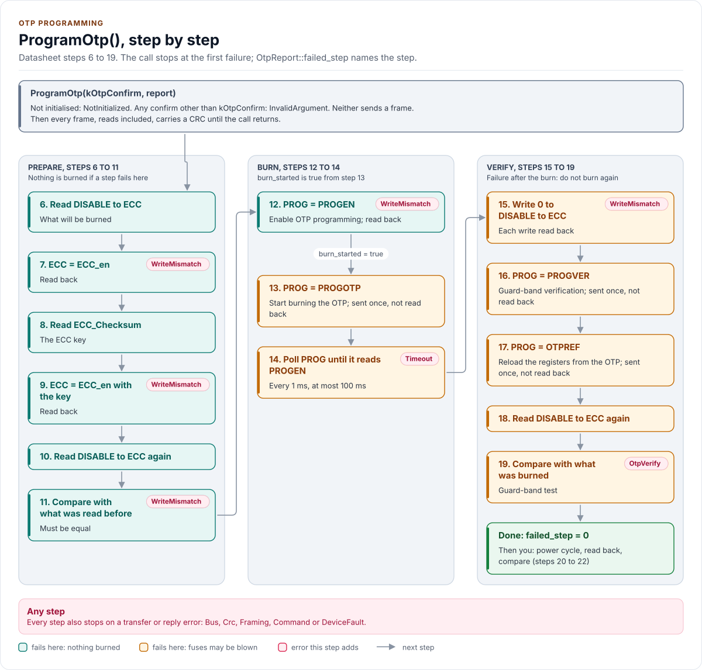

# OTP programming

How to make the zero position and the settings permanent: when to burn, what `ProgramOtp()` does, what you do
before and after it, and what a failure means.

<!-- generated: datasheet-refs -->
??? abstract "Datasheet sections this page relies on"

    From ams OSRAM DS000637 v1-01:

    - OTP burn and verification: Burn and Verification of the OTP Memory; Step-by-Step Procedure (Figure 60), p. 39

    All of them, with the driver API for each: [Datasheet map](datasheet.md).
<!-- /generated -->

The settings registers DISABLE, ZPOSM, ZPOSL, SETTINGS1 to SETTINGS3 and ECC (0x0015 to 0x001B) are volatile copies of a
one-time-programmable memory. `EnsureInitialized()`, `ApplyConfig()` and the setters write the volatile copy: it works
at once and is lost at the next power cycle. Burning the OTP keeps it for good, and a chip can be burned **once**.

!!! danger "One attempt per chip"
    A burn cannot be repeated or undone, and the datasheet requires a part that fails verification to be
    scrapped. Run the product with the settings in volatile form first, and burn only when every setting is final.

`ProgramOtp()` is **not verified on hardware**: it follows the datasheet procedure and is tested step by step on the
register model, which does not model the fuses, the guard band or the ECC algorithm.

## When to burn

| Situation | Burn? |
| --- | --- |
| The MCU writes the settings at every start-up (`EnsureInitialized()` with `Config`) | No: nothing is lost at power-off, because the driver writes them again |
| The ABI, UVW or PWM outputs must be right before any MCU talks to the chip | Yes: only the OTP holds settings through power-up |
| The zero position must survive without an MCU (a stand-alone encoder) | Yes |
| Settings may still change, or the magnet may be re-fitted | No |

A burned part starts from its OTP content; initialise it with `Config::write_settings = false` so the driver reads
the settings instead of overwriting them ([Configuration](configuration.md#otp-burned-parts)).

## Conditions

| Parameter | Value |
| --- | --- |
| Supply during the burn, 5 V mode | 4.5 V to 5.5 V on VDD, 1 µF on VDD3V3 |
| Supply during the burn, 3.3 V mode | 3.3 V to 3.5 V (narrower than the 3.0 V to 3.6 V operating range) |
| Current | Up to 100 mA during the burn: the supply must deliver it |
| Temperature | 5 °C to 45 °C |
| Port | Implements `DelayUs()`, as every port must; without it the driver does not compile |

## The procedure

The datasheet's "Step-by-Step Procedure to Permanently Program the Non-Volatile Memory" and its flowchart
(Figure 60), and who does each step. `ProgramOtp()` checks every step and stops at the first that fails;
`OtpReport::failed_step` names it.

<!-- figure: otp-flow -->
<picture>
  <source media="(prefers-color-scheme: dark)" srcset="diagrams/otp-flow.dark.svg">
  
</picture>
<!-- /figure -->

| Step | Datasheet | Who |
| --- | --- | --- |
| 1 | Power-on cycle | You, before the call |
| 2, 3 | Write the settings; place the magnet at the zero position | You: `EnsureInitialized()` or `ApplyConfig()` with the final `Config` |
| 4, 5 | Read the angle, write it into ZPOSM and ZPOSL | You: `SetZeroHere()`, or `SetZeroPosition()` with a known value |
| 6 | Read DISABLE to ECC | `ProgramOtp()` |
| 7 to 9 | ECC = ECC_en, read the key from ECC_Checksum (0x3FD0), ECC = ECC_en with the key | `ProgramOtp()`, each write read back: `WriteMismatch` at 7 or 9 |
| 10, 11 | Read DISABLE to ECC again and compare | `ProgramOtp()`: `WriteMismatch` on a difference |
| 12 | PROG = PROGEN | `ProgramOtp()`, read back: `WriteMismatch` on a difference |
| 13 | PROG = PROGOTP: the burn starts | `ProgramOtp()`: sent once, never retried; `burn_started` is set |
| 14 | Poll PROG until it reads PROGEN alone | `ProgramOtp()`: every 1 ms, `Timeout` after `kOtpBurnTimeoutMs` (100 ms) |
| 15 | Write 0 into DISABLE to ECC | `ProgramOtp()`, each write read back: `WriteMismatch` on a difference |
| 16, 17 | PROG = PROGVER (guard band), PROG = OTPREF (reload from the OTP) | `ProgramOtp()` |
| 18, 19 | Read DISABLE to ECC and compare with what was burned (guard-band test) | `ProgramOtp()`: `OtpVerify` on a difference |
| 20 to 22 | Power-on cycle, read the registers, compare | You, after the call: `ReadNonVolatile()` against `OtpReport::written` |

The step text names 0x0016 to 0x001B; Figure 60 reads and clears 0x0015 (DISABLE) too, which is also
non-volatile, so the driver reads, burns and compares all seven registers. Every frame of the procedure, reads
included, is a CRC-protected 24-bit frame (32-bit with `Bits32`), even when `Config::frame` is `Bits16`; the frame
format is restored afterwards. A corrupted read in the compares of steps 11 and 19 would otherwise go unnoticed.
The writes of steps 7, 9, 12 and 15 are always read back, unlike a run-time write without `Verify::ReadBack`: the
burn cannot be undone and is not timing-critical. The PROG commands of steps 13, 16 and 17 start an action and are
sent once, never read back.

## Use it

```cpp
--8<-- "tests/docs/api_tasks.cpp:otp"
```

`kOtpConfirm` is the typed confirmation (`OtpBurnConfirm`) that `ProgramOtp()` requires as its first argument, so
that a stray call or a corrupted argument cannot burn the part: an integer does not compile, and an `OtpBurnConfirm`
with any other code returns `InvalidArgument` and sends nothing.

After the call, cycle the supply (step 20), restart with `write_settings = false` (`Deinitialize()`, `ApplyConfig()`
with that configuration, `EnsureInitialized()`), then compare
`ReadNonVolatile()` with `OtpReport::written` (steps 21 and 22). They must be equal.

## When it fails

`ProgramOtp()` returns the error and fills `OtpReport`:

| Field | Meaning |
| --- | --- |
| `failed_step` | The datasheet step that failed, 6 to 19; 0 when every step succeeded |
| `burn_started` | True once step 13 was sent: the fuses may be blown, even if a later step failed |
| `written` | DISABLE to ECC as checked in step 11: what was burned |

| Error | `burn_started` | What to do |
| --- | --- | --- |
| `NotInitialized`, `InvalidArgument` | false | Nothing was sent: initialise, pass `kOtpConfirm` |
| `Bus`, `Crc`, `Framing`, `Command`, `DeviceFault` at steps 6 to 12, or `WriteMismatch` at steps 7, 9, 11 or 12 | false | Nothing was burned: fix the cause ([Troubleshooting](troubleshooting.md)) and call again |
| Any error at step 13 or later (`WriteMismatch` at step 15) | true | Do not burn again. Cycle the supply and compare `ReadNonVolatile()` with `written`. If they differ, scrap the part |
| `Timeout` (step 14) | true | The burn did not finish in 100 ms: check the supply current and voltage, then as above |
| `OtpVerify` (step 19) | true | The part failed the guard-band test: scrap it, as the datasheet requires |

## Safety notes

- Burn on the bench or in an end-of-line station, never from a code path that runs in the field. Keep the call out
  of the normal firmware image if you can.
- Check the supply and temperature limits above before the call; the driver cannot measure them.
- Do not cut power during the burn (steps 13 and 14).
- `ProgramOtp()` burns what the volatile registers hold at step 6. Read them with `ReadNonVolatile()` first if
  anything else may have written them.

Next: [Configuration](configuration.md) lists every setting the burn makes permanent.
